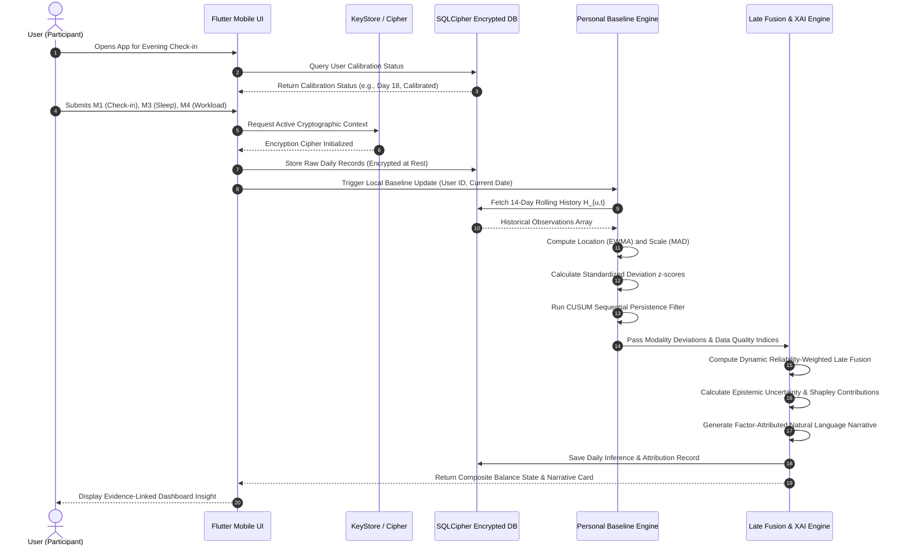
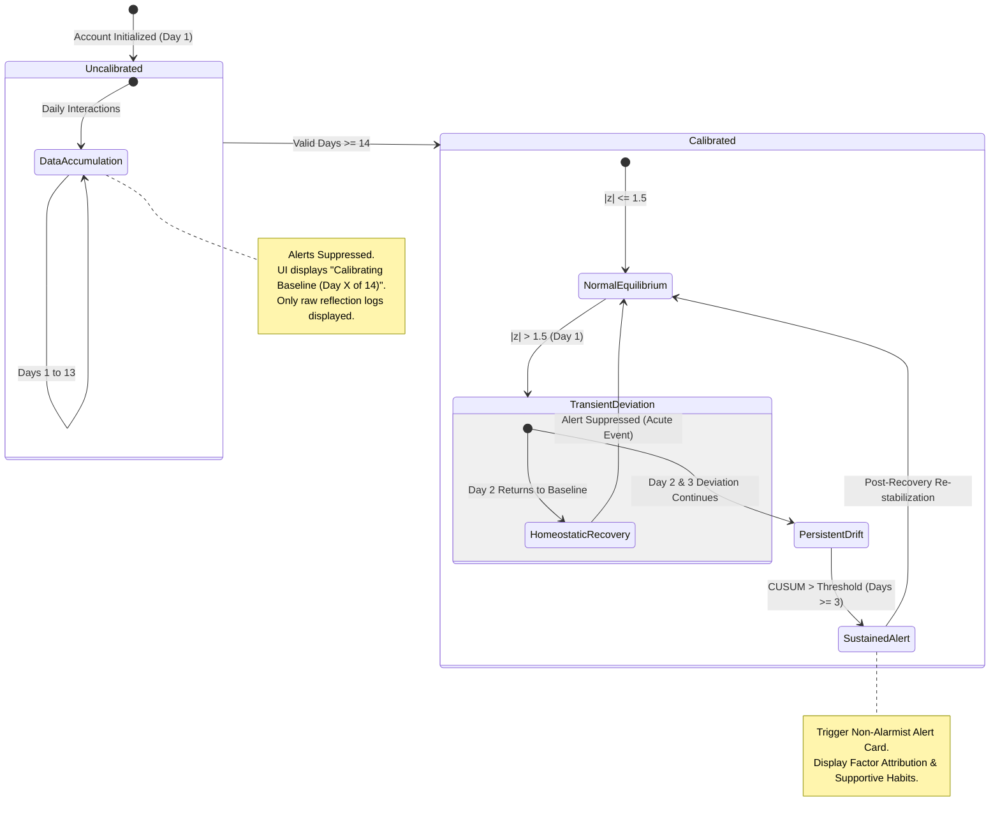
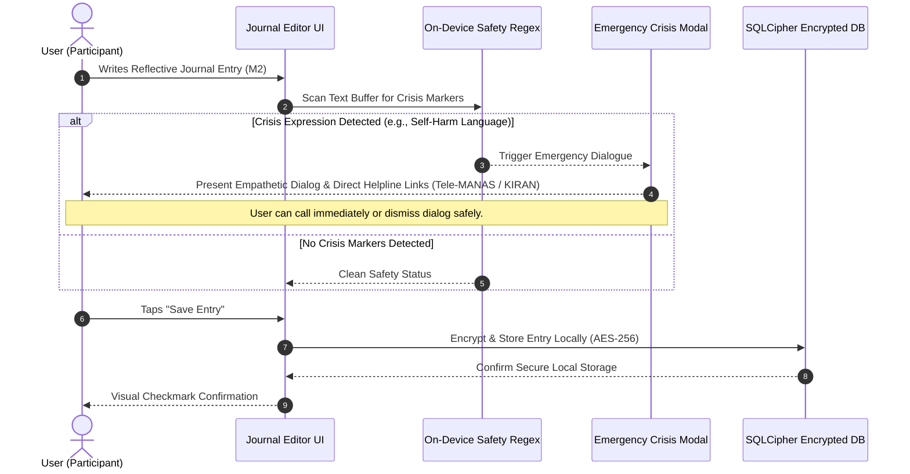
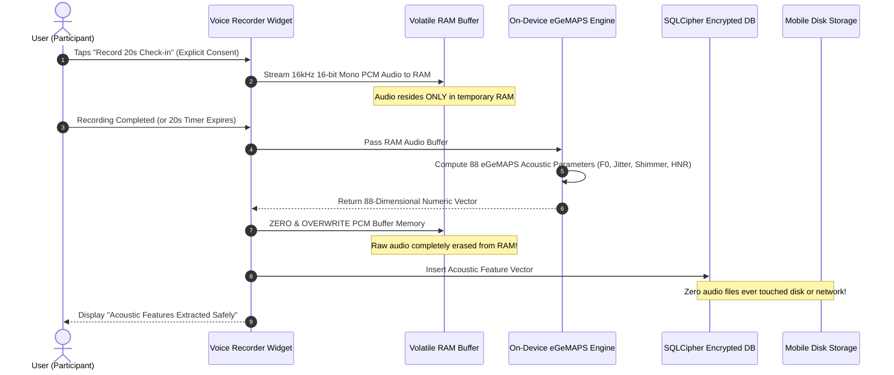

# MindPulse (SENSE) — Detailed System Flows & Sequence Diagrams
## End-to-End Dynamic Interaction Flows & State Transitions

---

## 1. Daily User Check-in & Inference Sequence

---

## 2. Baseline Calibration State Transition Flow

---

## 3. On-Device Text Journal & Safety Interceptor Flow

---

## 4. Ephemeral Voice Processing & Zero-Storage Flow (Modality M5)

