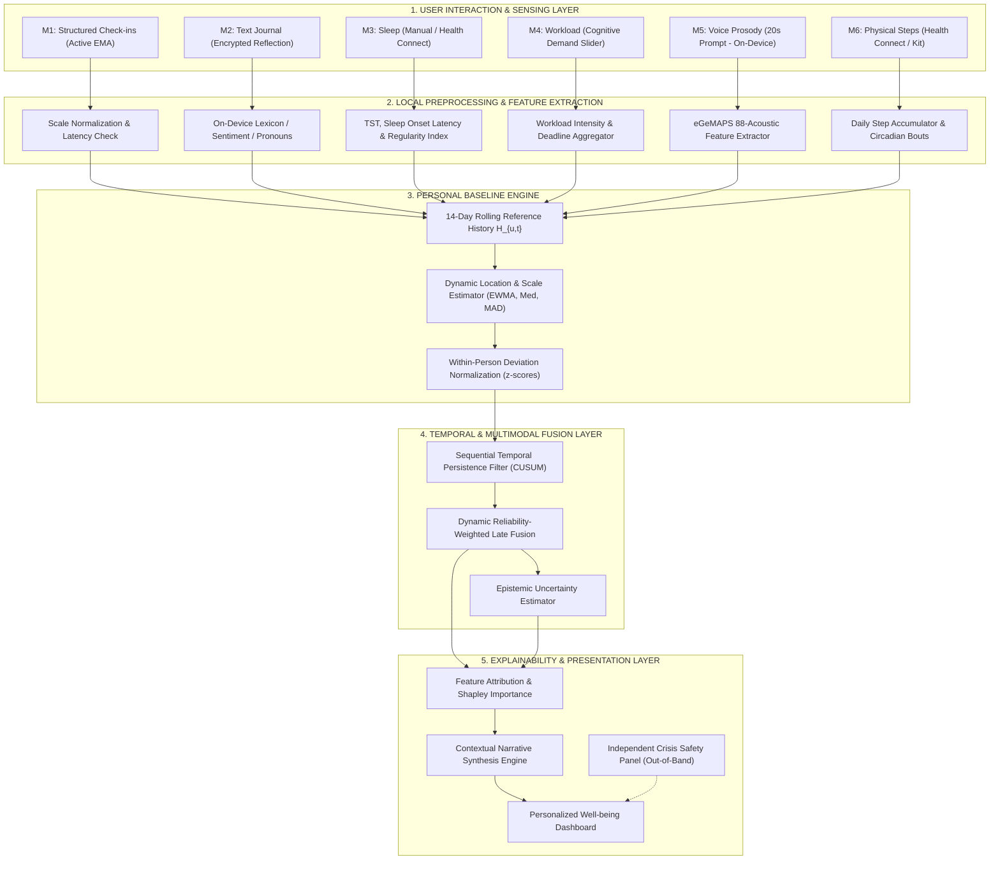

# MindPulse (SENSE) — System & ML Pipeline Architecture
## End-to-End Multimodal Machine Learning & Mobile Architecture

---

## 1. High-Level System Architecture Diagram

---

## 2. Pipeline Stage Breakdown

### 2.1 Stage 1: Modality Preprocessing & Feature Extraction
Each modality independently standardizes raw user inputs into structured daily numerical representations:
- **M1 (Check-in):** Normalizes Likert ratings (1–5) to $[0, 1]$ interval; checks completion latency (flags response times $<2.0$s as potential random tapping).
- **M2 (Journal):** Evaluates lexical sentiment valence $V_{\text{text}} \in [-1, 1]$, subjectivity $S_{\text{text}} \in [0, 1]$, and Pennebaker first-person singular pronoun density $P_{\text{self}} \in [0, 1]$.
- **M3 (Sleep):** Calculates Total Sleep Time in hours, deviation from target rest, and Sleep Regularity Index (SRI).
- **M4 (Workload):** Combines subjective mental demand $D \in [1, 5]$ and effort $E \in [1, 5]$ with deadline urgency weighting: $W_{\text{load}} = 0.5 D + 0.5 E + 0.2 \min(N_{\text{deadlines}}, 5)$.
- **M5 (Voice):** Extracts the 88 eGeMAPS acoustic features (pitch $F_0$ mean, $F_0$ SD, jitter, shimmer, HNR, speech rate, pause ratio). Raw audio buffer is zeroed out immediately.
- **M6 (Activity):** Aggregates daily steps and computes deviation from personal target.

---

### 2.2 Stage 2: Personal Baseline Engine
The engine maintains a historical memory buffer $\mathcal{H}_{u,t}^{(m)}$ of the preceding $W = 14$ valid observations for each modality $m$:
- **Location Estimator (EWMA):**
  $$\mu_{u,t}^{(m)} = \lambda x_{u,t-1}^{(m)} + (1 - \lambda) \mu_{u,t-1}^{(m)} \quad (\text{with } \lambda = 0.15)$$
- **Dispersion Estimator (Moving Median Absolute Deviation):**
  $$\sigma_{u,t}^{(m)} = 1.4826 \cdot \text{median}\left(\left|x_{u,\tau}^{(m)} - \text{median}(\mathcal{H}_{u,t}^{(m)})\right|\right)$$
- **Standardized Deviation ($z$-score):**
  $$z_{u,t}^{(m)} = \frac{x_{u,t}^{(m)} - \mu_{u,t}^{(m)}}{\max\left(\sigma_{u,t}^{(m)}, \, \epsilon\right)}$$

---

### 2.3 Stage 3: Temporal Persistence & Change Detection
To ensure transient 1-day events (e.g., an acute project delivery) do not trigger alarmist alerts, a **Cumulative Sum (CUSUM) Persistence Filter** tracks sustained upward drift:

$$C_{u,t}^{(m)} = \max\left(0, \, C_{u,t-1}^{(m)} + z_{u,t}^{(m)} - k\right)$$

where $k = 0.5$ is the allowance parameter. A modality shift is flagged when $C_{u,t}^{(m)} > h$ ($h = 4.0$).

---

### 2.4 Stage 4: Dynamic Late Decision Fusion
On day $t$, observed modalities $O_{u,t} \subseteq \mathcal{M}$ are combined into a composite stress shift score $S_{u,t}$:

$$S_{u,t} = \frac{\sum_{m \in O_{u,t}} w_m \cdot r_{u,t}^{(m)} \cdot \sigma\left(z_{u,t}^{(m)}\right)}{\sum_{m \in O_{u,t}} w_m \cdot r_{u,t}^{(m)}}$$

where:
- $\sigma(z) = \frac{1}{1 + e^{-z}}$ scales normalized deviations to the unit probability interval $[0, 1]$.
- $w_m$ is the prior modality importance weight ($\sum w_m = 1.0$).
- $r_{u,t}^{(m)}$ is the data quality index (e.g., audio SNR, check-in completion time sanity, completeness of sleep record).
- **Epistemic Uncertainty:**
  $$U_{u,t} = 1.0 - \sum_{m \in O_{u,t}} w_m$$
  If $U_{u,t} > 0.6$ (e.g., only one low-weight modality submitted), alerts are suppressed and the system reports: *"Insufficient observations today to estimate balance."*

---

### 2.5 Stage 5: Explainability & Narrative Synthesis
Instead of an opaque number, the dashboard presents factor-attributed explanations:
- Rank modality contributions: $\Delta_m = w_m \cdot r_{u,t}^{(m)} \cdot (s_{u,t}^{(m)} - 0.5)$.
- Identifies the top two contributors and maps them to human-readable contextual narratives:
  > *"Your stress patterns appear elevated over the past 3 days. The primary contributing factor is a 2.1-hour drop in your typical sleep duration compared to your 14-day baseline, combined with higher reported cognitive workload. Your vocal prosody also indicated lower pitch variability during check-in."*

