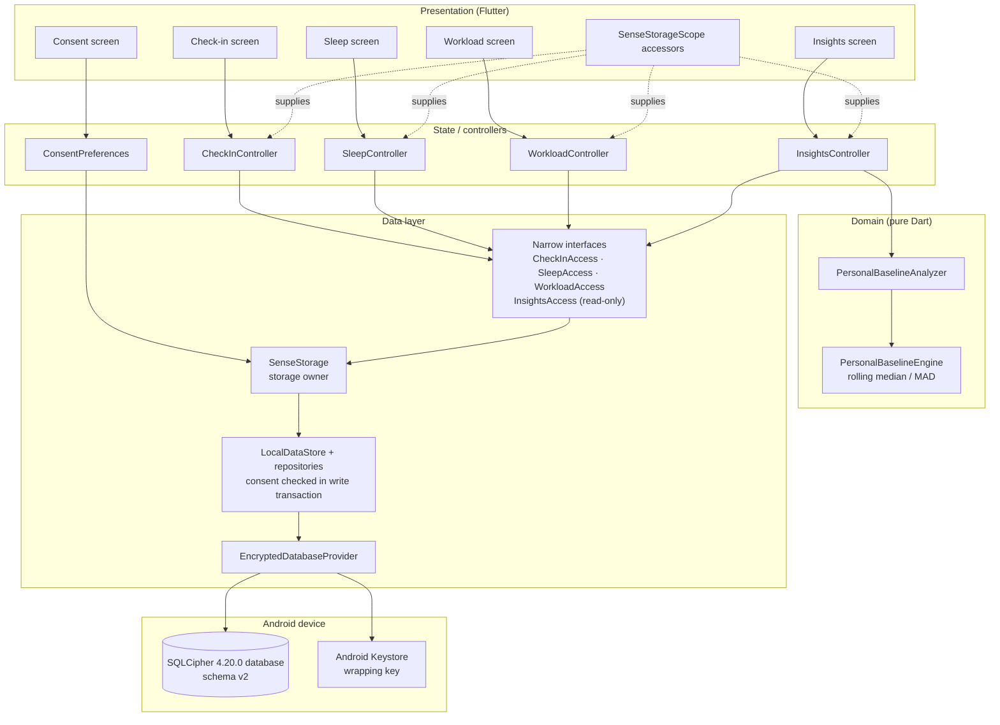

# SENSE: System Architecture (as implemented)

This document describes the architecture that exists in the repository (commit `fe8cd77` plus the uncommitted Workload feedback and Insights work). Components that are planned but not built are listed separately at the end and are not drawn as implemented. Encryption details are in `../architecture/encrypted_local_storage.md`; design decisions are in `../decisions.md` (ADR-009 and its K1 to K4 and Milestone E implementation records).

---

## 1. Layers

| Layer | Responsibility | Location |
|---|---|---|
| Presentation | Flutter screens and widgets (Living Landscapes design). No database or repository access. | `mobile/lib/presentation/` |
| State / controllers | One `ChangeNotifier` controller per screen (`CheckInController`, `SleepController`, `WorkloadController`, `InsightsController`) plus the shared `ConsentPreferences`. Hold form state, provenance, save locking and typed outcomes. | `mobile/lib/core/state/` |
| Domain | Pure Dart calculations: the existing `PersonalBaselineEngine` and the `PersonalBaselineAnalyzer` that applies it to one variable. | `mobile/lib/domain/` |
| Narrow access interfaces | Typed, minimal surfaces handed to controllers: `CheckInAccess`, `SleepAccess`, `WorkloadAccess` (load a day, save) and the read-only `InsightsAccess` (load a window). No database, store or repository is exposed. | `mobile/lib/data/local/*_records.dart` |
| Storage owner | `SenseStorage`: the single owner of the encrypted connection; decides what this build may open; supplies the narrow interfaces; reached by screens only through `SenseStorageScope` accessor functions. | `mobile/lib/data/local/sense_storage.dart`, `mobile/lib/presentation/widgets/sense_storage_scope.dart` |
| Repositories | Existing typed repositories (`CheckInRepository`, `SleepRepository`, `WorkloadRepository`, `ConsentRepository`, `LocalProfileRepository`) bound by `LocalDataStore`; consent authorization inside each write transaction. | `mobile/lib/data/local/repositories.dart`, `sqlite_repositories.dart`, `local_data_store.dart` |
| Encrypted database | SQLCipher 4.20.0 database; passphrase wrapped by an Android Keystore key; lifecycle lease; schema version 2 with one row per person per local date. | `mobile/lib/data/local/encrypted/`, `mobile/android/app/src/main/kotlin/` |

Static architecture guards (`mobile/test/sense_storage_test.dart`, `mobile/test/local_data_foundation_test.dart`, using the analyzer-based helper `mobile/test/support/dart_source_guard.dart`) fail the build's test suite if presentation code reaches the database, a repository, the storage owner's internals or another screen's interface, or if any export from the storage owner lacks an explicit `show` list.

## 2. Architecture diagram



## 3. Storage lifecycle and the development namespace

`SenseApp` (`mobile/lib/main.dart`) creates one `SenseStorage` from the build policy and calls `start()`:

| Build | `--dart-define=SENSE_DEV_STORAGE=1` | What opens | Screens |
|---|---|---|---|
| debug | not set (default) | nothing | prototype "not saved" behaviour; sample Insights |
| debug | set | the isolated **development namespace** (own directory, Keystore alias, lease; never production eligible) | real saves to development storage; persistent banner "DEVELOPMENT DATA — NOT FOR PARTICIPANTS" |
| profile | any | nothing (refused in Dart, by the provider and natively) | prototype behaviour |
| release | any | nothing at startup (participant collection is not enabled) | prototype behaviour |

Opening is fail closed: any key, envelope, engine or lifecycle failure leaves storage unavailable, with no plaintext fallback, no retry with another engine and no reset. The storage owner closes the connection when the engine detaches. The participant database is never opened by the app in this version.

## 4. Consent persistence and authorization

- Six modality preferences (M1 to M6), all off by default, stored as append-only `consent_events` (the latest event per modality wins).
- The Consent screen and Settings change preferences through `ConsentPreferences`, which appends an event and shows the change only after the write succeeded.
- **Writes:** each daily repository `upsert` runs `requireConsent` for its modality (M1 check-ins, M3 sleep, M4 workload) inside the same transaction as the write; an off or never-recorded preference refuses the write and nothing is written.
- **Insights reads:** `ObservationRecordService.loadWindow` reads the consent snapshot and, only for modalities whose latest event is on, the repository `range`, all in one transaction. Records of a modality that is off never leave the data layer.
- In-memory preferences never authorize anything; static guards check that the input and Insights controllers and screens do not read `ConsentPreferences`. Revoking consent blocks later writes and hides the modality in Insights; earlier records remain stored.

## 5. Data flow

```mermaid
sequenceDiagram
  autonumber
  actor P as Person
  participant S as Check-in / Sleep / Workload screen
  participant C as Controller
  participant A as Narrow access (save)
  participant R as Repository (transaction)
  participant D as Encrypted database
  participant I as Insights screen
  participant IC as InsightsController
  participant IA as InsightsAccess (read-only)
  participant E as Baseline engine

  P->>S: enters values, presses Save / Finish
  S->>C: save() (inputs locked while saving)
  C->>C: build entry (local day; provenance; date-change check)
  C->>A: save(entry)
  A->>R: byDate + upsert in one transaction
  R->>D: requireConsent(M1/M3/M4) then insert or update
  D-->>R: committed (or consent denied: nothing written)
  R-->>C: typed outcome (saved / updated / consentDenied / failed)
  C-->>S: success shown only after commit

  P->>I: opens Insights tab
  I->>IC: refresh() (previous results cleared)
  IC->>IA: loadWindow(last 14 local days)
  IA->>D: consent snapshot + range per consented modality (one transaction)
  D-->>IA: committed records only
  IA-->>IC: records, or "consent off" per modality
  IC->>E: one 14-day series per variable (missing = null)
  E-->>IC: median, scale, z-score
  IC-->>I: per-variable state: insufficient / no spread / usable
```

## 6. Input-specific flows

| Input | Stored fields (table) | Day the record belongs to | Notes |
|---|---|---|---|
| Check-in (M1) | `mood_rating`, `motivation_energy_rating`, `perceived_stress_rating` (`check_ins`), each 1 to 5 | local day of the check-in | Two steps; the completion page appears only after the commit. |
| Sleep (M3) | `duration_minutes` (240 to 720, multiples of 30), `bedtime_local`, `wake_time_local` (strict `HH:MM`), `rest_quality` 1 to 5, `source = MANUAL_LOG` (`sleep_records`) | local date of **wake-up** | Duration is its own answer, never derived from the times; 7-day history from saved records only. |
| Workload (M4) | `mental_demand` 1 to 5, `effort` 1 to 5, `deadlines_48h` 0 to 20 (`workload_records`) | local day | Save feedback is inline above the Save button. |

Common to all three: field-level provenance (`changed_fields`, `default_fields`, `submitted_at_utc`); a second save the same day updates the same record (same id and creation time); inputs, Save and navigation are locked while a save is in progress; if the local date changes before saving, nothing is written for the earlier date and the new day is loaded for review.

## 7. Insights flow

`InsightsController` asks `InsightsAccess` for the last 14 local days, maps each committed record to its variables (sleep duration in hours, on the wake-up date), and passes one day-indexed series per variable (missing days null) to `PersonalBaselineAnalyzer`, which calls `PersonalBaselineEngine.computeRollingMadBaseline`. Results are cleared before every read and whenever storage closes; the screen reads again each time the tab is shown and after returning from the consent preferences. The method is described in `methodology.md`.

## 8. Not implemented (not drawn above)

Journal persistence (M2), Voice (M5), Activity (M6), Settings Export and Erase, multimodal fusion (the existing late-fusion engine in `mobile/lib/domain/late_fusion_engine.dart` is not connected to any screen), EWMA/CUSUM presentation, participant-data storage at startup, cloud or remote components. The Python research pipeline (`backend/`, `ml/`) and the Rust CLI (`backend-rust/`) are separate research/reference code and are not part of the app.
